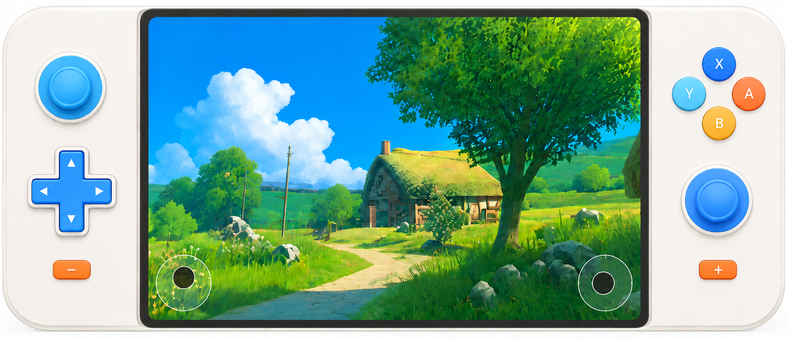
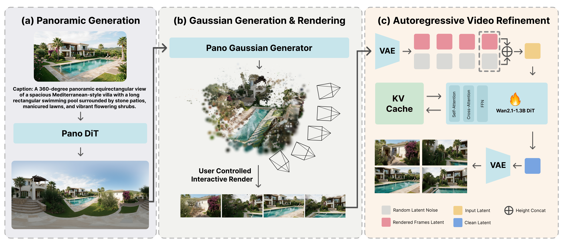

# MoVerse: Real-Time Video World Modeling with Panoramic Gaussian Scaffold

<div align="center">
  
</div>

<div align="center">
  <a href="https://orange-3dv-team.github.io/MoVerse"></a> &ensp;
  <a href="https://arxiv.org/abs/2606.13376"></a> &ensp;
  <a href="https://huggingface.co/Orange-3DV-Team/MoVerse"></a> &ensp;
  <a href="https://github.com/Orange-3DV-Team/MoVerse"></a>
</div>

## 📢 About

**TL;DR:** We propose MoVerse, a method that builds a navigable 3D world from a single narrow-field-of-view image and renders interactive video in real time on a single RTX 4090. MoVerse separates world construction from observation rendering through a three-stage pipeline, producing coherent and photorealistic free-roaming video walkthroughs.

**Features:** MoVerse generates high-quality real-time navigable worlds from a single input image, supporting:
- **Panoramic Generation**: Expands a single NFOV image into a gravity-aligned, horizontally periodic 360° ERP panorama via topology-aware latent diffusion
- **3D Gaussian Scaffold**: Lifts the panorama into a panoramic 3D Gaussian scaffold using feed-forward residual prediction in angular–inverse-depth space
- **Autoregressive Video Refinement**: Translates scaffold renderings along user-specified camera trajectories into photorealistic video at **8 FPS on a single RTX 4090**
- **Free-Roaming Walkthrough**: Supports user-controlled camera trajectories with temporally coherent real-time rendering (WASD + mouse controls)
- **Headless Pipeline**: Full image-to-video generation from the command line
- **Diverse Scenes**: Works across indoor and outdoor scenes — from ancient ruins to cyberpunk streets, anime landscapes to realistic interiors

<div align="center">
  

https://github.com/user-attachments/assets/e0904e7a-4ea9-4ec6-944d-6be1ca20fc26


  <p><em>Frontend demo: scene creation from image + prompt → live streaming video generation</em></p>
</div>

## 🏗️ Pipeline

Given a single narrow-field-of-view image, MoVerse separates world construction from observation rendering:

```
INPUT (NFOV image)
  → STAGE I:   Panoramic Generation (single image → 360° ERP)
  → STAGE II:  3D Gaussian Scaffold (panorama → splattable 3D asset)
  → STAGE III: Autoregressive Video Refinement (scaffold → real-time roaming video)
OUTPUT (navigable world)
```

<div align="center">
  
</div>

## 🎥 Preview

Visit our [Project Page](https://orange-3dv-team.github.io/MoVerse) to view complete demo videos, interactive 360° panorama viewers, and 3D Gaussian scaffold visualizations.

## 📋 Requirements

- **GPU**: NVIDIA GPU with at least 24 GB VRAM (RTX 4090, A100, H100 tested)
- **OS**: Linux (Ubuntu 20.04+ recommended)
- **RAM**: 64 GB
- **Python**: 3.10
- **Node.js**: 18+ (for frontend)
- **ffmpeg**: required for video compilation

## 🚀 Quick Start

### 1. Clone & Install Dependencies

```bash
git clone https://github.com/Orange-3DV-Team/MoVerse.git
cd MoVerse

# System packages
sudo apt update
sudo apt install ffmpeg

# Python environment
conda create -n moverse python=3.10 -y
conda activate moverse
pip install -r requirements.txt

# flash-attn (builds CUDA kernels — can take 10+ minutes)
# If the build fails, install a pre-built wheel matching your CUDA version:
#   pip install flash-attn --no-build-isolation
# Or use conda:
#   conda install flash-attn -c conda-forge

# DA3 (Depth Anything 3) — NOT on PyPI, install from source
git clone https://github.com/ByteDance-Seed/Depth-Anything-3.git /tmp/Depth-Anything-3
cd /tmp/Depth-Anything-3 && pip install -e . && cd -

# Frontend
cd world_engine && npm install && cd ..
```

### 2. Download Model Weights

> **Note:** `FLUX.1-Fill-dev` is a gated model. Visit [the model page](https://huggingface.co/black-forest-labs/FLUX.1-Fill-dev) and accept the license terms before downloading.
>
> **Note:** If you are behind a firewall or in a region without direct HuggingFace access, set `HF_ENDPOINT=https://hf-mirror.com` before running the script below.

```bash
./scripts/download_weights.sh
```

This downloads all weights to `checkpoints/`:

| Weight | Source | Path |
|--------|--------|------|
| AutoLevel | `Orange-3DV-Team/MoVerse` | `checkpoints/gimbal360/autolevel.pth` |
| Pano LoRA | `Orange-3DV-Team/MoVerse` | `checkpoints/gimbal360/pytorch_lora_weights.safetensors` |
| Gaussian Predictor | `Orange-3DV-Team/MoVerse` | `checkpoints/gaussian_predictor_checkpoint.pth` |
| Self-Forcing Video | `Orange-3DV-Team/MoVerse` | `checkpoints/self_forcing_video.pt` |
| TAEHV VAE | `Orange-3DV-Team/MoVerse` | `checkpoints/taew2_1.pth` |
| FLUX.1-Fill-dev | `black-forest-labs/FLUX.1-Fill-dev` | `checkpoints/FLUX.1-Fill-dev/` |
| DA3 | `depth-anything/DA3NESTED-GIANT-LARGE-1.1` | `checkpoints/DA3NESTED-GIANT-LARGE-1.1/` |
| Wan2.1-T2V-1.3B | `Wan-AI/Wan2.1-T2V-1.3B` | `checkpoints/Wan2.1-T2V-1.3B/` |

> **Note:** `gaussian_predictor_checkpoint.pth` includes DINOv3 encoder weights (`pretrained=False`, `strict=False`). No separate DepthAnythingV2 download needed.

### 3. Build Frontend

```bash
cd world_engine && npm run build && cd ..
```

### 4. Run

#### Real-Time Streaming Server

```bash
bash run_sh/run_web_server_pano_gs.sh
```

Open `http://localhost:8889/moverse/` in your browser. Use **WASD** or the on screen **D-Pad** to move, **arrows** or **mouse drag** to look around, **Shift** for speed boost.

The web UI includes a **Create New Scene** wizard: upload a perspective image, enter a prompt, and the system generates panorama → depth → 3DGS automatically.

#### Headless Pipeline (CLI)

```bash
# Full pipeline: image → panorama → depth → 3DGS → video (gen + render + side-by-side)
./scripts/run_pipeline.sh --example

# Or with your own image
./scripts/run_pipeline.sh \
    --image path/to/input.png \
    --prompt "your scene description" \
    --back_prompt "description of unseen areas" \
    --traj examples/alcove/trajectory.txt \
    --output_dir output
```

Outputs: `video.mp4` (generated), `video_render.mp4` (Gaussian render), `video_side_by_side.mp4` (comparison).

## 📁 Project Structure

```
MoVerse/
├── pano_gen/              # Stage I — Panorama generation (FluxFill + AutoLevel + LoRA)
├── gaussian_gen/          # Stage II — 3DGS generation (Depth-guided Feed-forward Gaussian Splatting)
├── world_engine/          # Stage III — Real-time streaming server + Vue frontend
├── scripts/               # Headless pipeline & weight download
├── examples/              # Example input image + trajectory
├── checkpoints/           # Model weights (gitignored, downloaded by script)
├── pipeline/              # CausalInferencePipeline
├── configs/               # Inference config
├── model/                 # Model definitions
├── utils/                 # Utilities (Wan2.1 wrapper, etc.)
└── demo_utils/            # TAEHV decoder
```

## 🎮 Controls

| Key | Action |
|-----|--------|
| W/A/S/D | Move forward/left/back/right |
| Arrows/Mouse drag | Look around |
| Shift | Speed boost |
| Speed Slider (UI) | Change movement or rotation speed |
| Gaussian Size Slider (UI) | Change Gaussians' sizes uniformally |
| Record button (UI) | Record gen + render + side-by-side video |

> Note that controls default to the render view at startup (before clicking the "Start denoising" button) so you can view the gaussian scene fast.

## 📖 Citation

```bibtex
@article{moverse2026,
  title   = {MoVerse: Real-Time Video World Modeling with Panoramic Gaussian Scaffold},
  author  = {Yang Zhou and Ziheng Wang and Yuqin Lu and Haofeng Liu and Jun Liang and Shengfeng He and Jing Li},
  journal = {arXiv preprint arXiv:2606.13376},
  year    = {2026}
}
```

## 🙏 Acknowledgements

This codebase builds on [Self-Forcing](https://github.com/guandeh17/Self-Forcing), [Wan2.1](https://github.com/Wan-Video/Wan2.1), [gsplat](https://github.com/nerfstudio-project/gsplat), [FLUX.1-Fill-dev](https://github.com/black-forest-labs/flux), [Depth Anything 3](https://github.com/ByteDance-Seed/Depth-Anything-3), [Apple ML-Sharp](https://github.com/apple/ml-sharp), [GEN3C](https://github.com/NVlabs/GEN3C), [CausVid](https://github.com/tianweiy/CausVid), [RAVEN](https://github.com/mvp-ai-lab/RAVEN), and [MemRoPE](https://github.com/YoungRaeKimm/MemRoPE).

## ⭐ Star

If you're interested in this project, please give us a Star ⭐ to receive timely open-source notifications!

---

<div align="center">
  <sub>Built with ❤️ by Orange Team, Youku Moku-Lab, HUJING Digital Media & Entertainment Group</sub>
</div>
